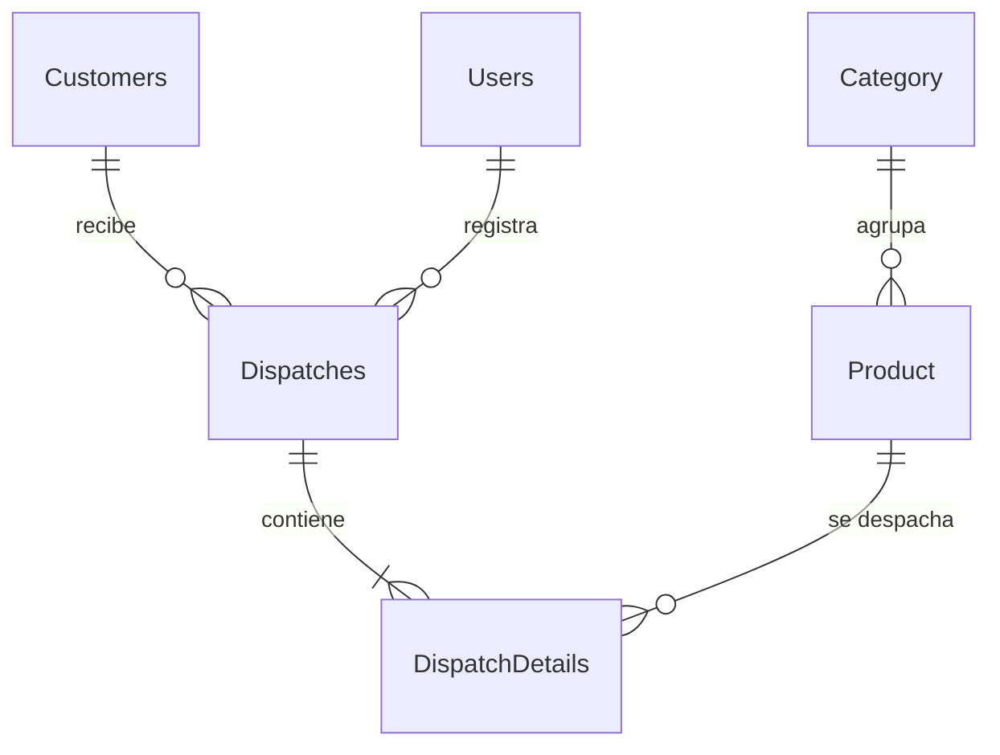

# Informe técnico — Módulo de Inventarios, Clientes y Despachos

**Proyecto:** POS San Magno
**Solución:** `POS.sln` (ASP.NET Core Web API + Blazor WebAssembly + librería compartida)
**Módulo desarrollado:** Inventarios (integración con productos/stock), Clientes y Despachos
**Fecha:** 19/11/2026

---

## 1. Resumen ejecutivo

Se implementó el módulo de **Clientes y Despachos** sobre la solución POS existente, integrándolo con el control de inventario ya disponible (Productos y Stock). El módulo permite:

- Registrar, consultar, editar y desactivar clientes.
- Registrar despachos de mercancía asociados a un cliente y a los productos del catálogo.
- Descontar stock de forma **atómica y transaccional** al crear un despacho.
- Avanzar el estado del despacho (`Pendiente → Enviado → Entregado`).
- Cancelar un despacho y **restituir automáticamente el stock** dentro de una transacción.
- Operar todo desde la interfaz Blazor con formularios, tablas, diálogos y validaciones.

La solución compila sin errores y la migración de base de datos fue aplicada correctamente en `POSDB` (SQL Server). Se realizaron pruebas de humo contra la API con resultados HTTP `200`, `201`, `400` y `401` según correspondía.

---

## 2. Introducción

El proyecto POS San Magno ya contaba con autenticación JWT, catálogo de productos, categorías, ventas, movimientos de stock y cierre de caja. La consigna solicitaba desarrollar el **Módulo de Inventarios, Clientes y Despachos**, con interfaz gráfica, lógica de negocio relacional (CRUD) y transacciones seguras en el control de mercancía.

Para cumplirla se agregaron dos dominios nuevos:

1. **Clientes**: datos maestros del receptor de la mercancía.
2. **Despachos**: documento que registra la salida de productos hacia un cliente, con detalle de ítems y estado de seguimiento.

El inventario se controla mediante la entidad `Product.CurrentStock` y el historial `Stock`, que ya existían. El despacho se integra a ese historial generando movimientos de tipo `Salida` al crear y de tipo `Entrada` al cancelar.

---

## 3. Objetivos

### Objetivo general

Desarrollar el módulo de Clientes y Despachos con formularios, controladores y lógica de negocio CRUD, garantizando transacciones seguras en el control del inventario.

### Objetivos específicos

- Modelar y crear las tablas `Customers`, `Dispatches` y `DispatchDetails` en SQL Server.
- Implementar repositorios, servicios y controladores REST para ambas entidades.
- Validar reglas de negocio (cliente activo, stock suficiente, documento único, transiciones de estado).
- Proteger la integridad del inventario con transacciones y actualizaciones condicionales.
- Construir la interfaz Blazor (páginas, diálogos y navegación).
- Verificar la compilación, la migración y el funcionamiento de los endpoints.

---

## 4. Alcance

### Incluido

- CRUD de clientes con baja lógica y validación de documento único.
- Creación y consulta de despachos con detalle de productos.
- Cambio de estado del despacho con reglas de avance.
- Cancelación de despacho con devolución de stock.
- Movimientos de inventario automáticos asociados a cada despacho.
- Interfaz de usuario integrada al menú y al inicio.

### Fuera de alcance de esta entrega

- Facturación electrónica, impuestos y descuentos.
- Devoluciones parciales.
- Guías de transporte e impresión física.
- Notificaciones por correo o integraciones externas.

---

## 5. Arquitectura de la solución

La solución mantiene la arquitectura por capas existente:

```text
POS.Client (Blazor WASM + MudBlazor)
        │  HttpClient (JWT Bearer)
        ▼
POS.Server (ASP.NET Core Web API)
  Controllers → Services → Repositories → AppDbContext
        │
        ▼
SQL Server (POSDB)
```

| Proyecto | Responsabilidad |
|---|---|
| `POS.Shared` | Entidades, DTOs y enums compartidos entre cliente y servidor |
| `POS.Server` | API REST, reglas de negocio, transacciones, acceso a datos con EF Core |
| `POS.Client` | Interfaz de usuario Blazor WebAssembly con MudBlazor |

Patrón aplicado: **Controller → Service → Repository → DbContext**, con inyección de dependencias registrada en `POS.Server/Program.cs`. Las operaciones que afectan inventario usan además `AppDbContext` directamente en el servicio para abrir transacciones explícitas.

---

## 6. Modelo de datos

### 6.1 Diagrama de relaciones



### 6.2 Relaciones

| Relación | Cardinalidad | Borrado |
|---|---|---|
| `Dispatches.CustomerId → Customers.Id` | Muchos a uno | `NO ACTION` (Restrict) |
| `Dispatches.UserId → Users.Id` | Muchos a uno | `NO ACTION` (Restrict) |
| `DispatchDetails.DispatchId → Dispatches.Id` | Uno a muchos | `CASCADE` |
| `DispatchDetails.ProductId → Product.Id` | Muchos a uno | `NO ACTION` (Restrict) |

Se usa `Restrict` en cliente, usuario y producto para **no borrar historial** de despachos. El detalle sí se elimina en cascada junto con su despacho (aunque la aplicación no elimina despachos, solo los cancela).

### 6.3 Entidades nuevas

```csharp
public class Customer
{
    public int Id { get; set; }
    public string Name { get; set; } = string.Empty;
    public string DocumentNumber { get; set; } = string.Empty;
    public string Email { get; set; } = string.Empty;
    public string Phone { get; set; } = string.Empty;
    public string Address { get; set; } = string.Empty;
    public bool IsActive { get; set; } = true;
    public DateTime CreatedAt { get; set; } = DateTime.Now;
}
```

```csharp
public class Dispatch
{
    public int Id { get; set; }
    public string DispatchNumber { get; set; } = string.Empty;
    public DateTime DispatchDate { get; set; } = DateTime.Now;
    public int CustomerId { get; set; }
    public Customer Customer { get; set; }
    public int UserId { get; set; }
    public User User { get; set; }
    public DispatchStatus Status { get; set; } = DispatchStatus.Pendiente;
    public decimal TotalAmount { get; set; }
    public string Notes { get; set; } = string.Empty;
    public ICollection<DispatchDetail> DispatchDetails { get; set; } = new List<DispatchDetail>();
}
```

```csharp
public class DispatchDetail
{
    public int Id { get; set; }
    public int DispatchId { get; set; }
    public Dispatch Dispatch { get; set; }
    public int ProductId { get; set; }
    public Product Product { get; set; }
    public int Quantity { get; set; }
    public decimal UnitPrice { get; set; }
    public decimal TotalPrice { get; set; }
}
```

### 6.4 Enumeración de estado

```csharp
public enum DispatchStatus
{
    Pendiente,
    Enviado,
    Entregado,
    Cancelado
}
```

Los enums viajan como enteros entre cliente y servidor (comportamiento por defecto de `System.Text.Json`), igual que el resto del proyecto.

---

## 7. Diccionario de datos

### 7.1 Tabla `Customers`

| Columna | Tipo | Nulo | Clave | Descripción |
|---|---|:---:|---|---|
| `Id` | `int` IDENTITY(1,1) | No | PK | Identificador |
| `Name` | `nvarchar(150)` | No | | Nombre o razón social |
| `DocumentNumber` | `nvarchar(30)` | No | UNIQUE | Documento / RUC del cliente |
| `Email` | `nvarchar(150)` | Sí | | Correo |
| `Phone` | `nvarchar(30)` | Sí | | Teléfono |
| `Address` | `nvarchar(250)` | Sí | | Dirección |
| `IsActive` | `bit` | No | | Baja/alta lógica |
| `CreatedAt` | `datetime2` | No | | Fecha de alta |

### 7.2 Tabla `Dispatches`

| Columna | Tipo | Nulo | Clave | Descripción |
|---|---|:---:|---|---|
| `Id` | `int` IDENTITY(1,1) | No | PK | Identificador |
| `DispatchNumber` | `nvarchar(20)` | Sí | Índice | Número legible `DSP-000001` |
| `DispatchDate` | `datetime2` | No | | Fecha y hora del despacho |
| `CustomerId` | `int` | No | FK → `Customers.Id` | Cliente receptor |
| `UserId` | `int` | No | FK → `Users.Id` | Usuario que registra |
| `Status` | `int` | No | | `0` Pendiente, `1` Enviado, `2` Entregado, `3` Cancelado |
| `TotalAmount` | `decimal(18,2)` | No | | Importe total |
| `Notes` | `nvarchar(max)` | Sí | | Observaciones |

### 7.3 Tabla `DispatchDetails`

| Columna | Tipo | Nulo | Clave | Descripción |
|---|---|:---:|---|---|
| `Id` | `int` IDENTITY(1,1) | No | PK | Identificador |
| `DispatchId` | `int` | No | FK → `Dispatches.Id` | Despacho (cascada) |
| `ProductId` | `int` | No | FK → `Product.Id` | Producto despachado |
| `Quantity` | `int` | No | | Cantidad |
| `UnitPrice` | `decimal(18,2)` | No | | Precio al momento del despacho |
| `TotalPrice` | `decimal(18,2)` | No | | `Quantity × UnitPrice` |

### 7.4 Índices

| Tabla | Índice | Único | Columnas |
|---|---|:---:|---|
| `Customers` | `IX_Customers_DocumentNumber` | Sí | `DocumentNumber` |
| `Dispatches` | `IX_Dispatches_DispatchNumber` | No | `DispatchNumber` |
| `Dispatches` | `IX_Dispatches_CustomerId` | No | `CustomerId` |
| `Dispatches` | `IX_Dispatches_UserId` | No | `UserId` |
| `DispatchDetails` | `IX_DispatchDetails_DispatchId` | No | `DispatchId` |
| `DispatchDetails` | `IX_DispatchDetails_ProductId` | No | `ProductId` |

---

## 8. Migración de base de datos

La migración se generó con EF Core y se aplicó a `POSDB`:

```powershell
dotnet ef migrations add AddCustomersAndDispatches --project POS.Server --startup-project POS.Server
dotnet ef database update --project POS.Server --startup-project POS.Server
```

Archivo generado:

```text
POS.Server/Migrations/20261119124714_AddCustomersAndDispatches.cs
```

El servidor aplica automáticamente las migraciones pendientes al arrancar mediante `DbSeeder.SeedAdminAsync` (`Database.MigrateAsync()`), por lo que en una instalación nueva el esquema se crea solo.

---

## 9. API REST

### 9.1 Clientes — `CustomersController`

Base: `api/Customers`. Requiere token JWT (`[Authorize]`).

| Método | Ruta | Rol | Descripción |
|---|---|---|---|
| GET | `/api/Customers` | Autenticado | Lista todos los clientes |
| GET | `/api/Customers/{id}` | Autenticado | Obtiene un cliente |
| POST | `/api/Customers` | Autenticado | Crea un cliente |
| PUT | `/api/Customers/{id}` | Autenticado | Actualiza un cliente |
| DELETE | `/api/Customers/{id}` | Administrador | Baja lógica del cliente |

### 9.2 Despachos — `DispatchesController`

Base: `api/Dispatches`. Requiere token JWT (`[Authorize]`).

| Método | Ruta | Descripción |
|---|---|---|
| GET | `/api/Dispatches` | Lista despachos con cliente, usuario y detalle |
| GET | `/api/Dispatches/{id}` | Obtiene un despacho |
| POST | `/api/Dispatches` | Crea un despacho y descuenta stock |
| PUT | `/api/Dispatches/{id}/status` | Avanza el estado del despacho |
| POST | `/api/Dispatches/{id}/cancel` | Cancela y restituye stock |

### 9.3 DTOs

```csharp
public class DispatchRequest
{
    public int CustomerId { get; set; }
    public int UserId { get; set; }        // lo asigna el controlador desde el JWT
    public string Notes { get; set; } = string.Empty;
    public List<DispatchItemDto> Items { get; set; } = new List<DispatchItemDto>();
}

public class DispatchItemDto
{
    public int ProductId { get; set; }
    public int Quantity { get; set; }
}

public class DispatchStatusUpdateRequest
{
    public DispatchStatus Status { get; set; }
}
```

Ejemplo de petición para crear un despacho:

```json
{
  "customerId": 1,
  "notes": "Entrega en almacén del cliente",
  "items": [
    { "productId": 3, "quantity": 2 },
    { "productId": 5, "quantity": 1 }
  ]
}
```

El `UserId` **no se confía al cliente**: el controlador lo obtiene del claim `NameIdentifier` del JWT.

---

## 10. Lógica de negocio

### 10.1 Reglas de clientes

- `Name` y `DocumentNumber` son obligatorios.
- `DocumentNumber` es único; se valida antes de insertar y antes de actualizar (excluyendo el propio cliente).
- El alta fuerza `IsActive = true` y registra `CreatedAt`.
- La actualización conserva el identificador y permite cambiar el estado activo/inactivo.
- La baja es **lógica** (`IsActive = false`) para preservar el historial de despachos.
- No se puede desactivar un cliente con despachos en estado `Pendiente` o `Enviado`.
- Un despacho solo puede crearse para un cliente **existente y activo**.

### 10.2 Reglas de despachos

- Debe tener al menos un producto.
- Cada cantidad debe ser mayor que cero.
- Los productos deben existir, estar activos y tener stock suficiente.
- Las líneas repetidas del mismo producto se agrupan y suman antes de validar stock.
- El precio unitario se toma del producto en el momento del despacho (precio histórico).
- El total se calcula como `Σ (UnitPrice × Quantity)`.
- El número legible se genera después del `INSERT` como `DSP-{Id:D6}` (por ejemplo `DSP-000001`).
- Al crear el despacho el estado inicial es `Pendiente`.
- El estado solo puede **avanzar**: `Pendiente → Enviado → Entregado`.
- Un despacho `Cancelado` no puede cambiar de estado.
- Un despacho `Entregado` no puede cancelarse.
- Cancelar un despacho `Pendiente` o `Enviado` devuelve las cantidades al inventario.

### 10.3 Matriz de transiciones

| Estado actual | Acción | Estado nuevo | ¿Permitido? |
|---|---|---|---|
| Pendiente | Marcar enviado | Enviado | Sí |
| Pendiente | Marcar entregado | Entregado | Sí |
| Pendiente | Cancelar | Cancelado | Sí |
| Enviado | Marcar entregado | Entregado | Sí |
| Enviado | Cancelar | Cancelado | Sí |
| Entregado | Cancelar | Cancelado | No |
| Cancelado | Cualquier cambio | — | No |

---

## 11. Transacciones y control de inventario

El punto crítico de la consigna es **garantizar transacciones seguras en el control de mercancía**. La implementación sigue el mismo patrón robusto que la venta existente:

1. Se validan los datos **antes** de abrir la transacción.
2. Se abre una transacción de base de datos (`BeginTransactionAsync`).
3. El descuento de stock se hace con `ExecuteUpdateAsync` **condicional** (`CurrentStock >= quantity`), lo que evita sobreventa por concurrencia.
4. Si la actualización afecta `0` filas, se hace `Rollback` y se devuelve un error.
5. El despacho, su detalle y los movimientos de stock se guardan dentro de la misma transacción.
6. Ante cualquier excepción se hace `Rollback` y se registra el error.

### 11.1 Creación del despacho (extracto real)

```csharp
await using var transaction = await _context.Database.BeginTransactionAsync();
try
{
    var dispatch = new Dispatch
    {
        DispatchDate = DateTime.Now,
        CustomerId = customer.Id,
        UserId = request.UserId,
        Status = DispatchStatus.Pendiente,
        Notes = request.Notes?.Trim() ?? string.Empty,
        DispatchDetails = new List<DispatchDetail>()
    };

    decimal total = 0;
    foreach (var (productId, quantity) in quantitiesByProduct)
    {
        var product = products[productId];
        var detail = new DispatchDetail
        {
            ProductId = product.Id,
            Quantity = quantity,
            UnitPrice = product.Price,
            TotalPrice = product.Price * quantity
        };
        dispatch.DispatchDetails.Add(detail);
        total += detail.TotalPrice;

        var affected = await _context.Product
            .Where(p => p.Id == productId && p.IsActive && p.CurrentStock >= quantity)
            .ExecuteUpdateAsync(setters => setters
                .SetProperty(p => p.CurrentStock, p => p.CurrentStock - quantity));
        if (affected == 0)
        {
            await transaction.RollbackAsync();
            return (null, $"Stock insuficiente para {product.Name}");
        }

        _context.Stocks.Add(new Stock
        {
            ProductId = product.Id,
            MovementDate = dispatch.DispatchDate,
            MovementType = MovementType.Salida,
            Quantity = quantity,
            Notes = "Salida por despacho",
            UserId = request.UserId
        });
    }

    dispatch.TotalAmount = total;
    await _dispatchRepository.AddAsync(dispatch);
    await _context.SaveChangesAsync();

    dispatch.DispatchNumber = $"DSP-{dispatch.Id:D6}";
    await _context.SaveChangesAsync();

    await transaction.CommitAsync();
    return (dispatch, null);
}
catch (Exception ex)
{
    await transaction.RollbackAsync();
    _logger.LogError(ex, "Error al registrar el despacho para el cliente {CustomerId}", request.CustomerId);
    return (null, "Error al registrar el despacho");
}
```

¿Por qué `ExecuteUpdateAsync` condicional? Porque dos cajeros podrían despachar el mismo producto al mismo tiempo. Si se leyera el stock y luego se restara en memoria, ambos podrían pasar la validación y dejar el stock negativo. La condición `CurrentStock >= quantity` se evalúa **en la base de datos**, de modo que solo una operación gana cuando queda poco stock.

### 11.2 Cancelación con restitución de stock (extracto real)

```csharp
await using var transaction = await _context.Database.BeginTransactionAsync();
try
{
    var dispatch = await _context.Dispatches
        .Include(d => d.DispatchDetails)
        .FirstOrDefaultAsync(d => d.Id == id);

    if (dispatch == null) { await transaction.RollbackAsync(); return (false, "El despacho no existe"); }
    if (dispatch.Status == DispatchStatus.Cancelado)
        { await transaction.RollbackAsync(); return (false, "El despacho ya está cancelado"); }
    if (dispatch.Status == DispatchStatus.Entregado)
        { await transaction.RollbackAsync(); return (false, "No se puede cancelar un despacho entregado"); }

    foreach (var detail in dispatch.DispatchDetails)
    {
        await _context.Product
            .Where(p => p.Id == detail.ProductId)
            .ExecuteUpdateAsync(setters => setters
                .SetProperty(p => p.CurrentStock, p => p.CurrentStock + detail.Quantity));

        _context.Stocks.Add(new Stock
        {
            ProductId = detail.ProductId,
            MovementDate = DateTime.Now,
            MovementType = MovementType.Entrada,
            Quantity = detail.Quantity,
            Notes = $"Cancelación de despacho {dispatch.DispatchNumber}",
            UserId = userId
        });
    }

    dispatch.Status = DispatchStatus.Cancelado;
    await _context.SaveChangesAsync();
    await transaction.CommitAsync();
    return (true, null);
}
catch (Exception ex)
{
    await transaction.RollbackAsync();
    _logger.LogError(ex, "Error al cancelar el despacho {DispatchId}", id);
    return (false, "Error al cancelar el despacho");
}
```

La cancelación devuelve el stock y registra un movimiento de `Entrada` en la misma transacción. Así el historial de inventario queda consistente con el estado del despacho.

---

## 12. Interfaz gráfica (Blazor + MudBlazor)

### 12.1 Páginas y rutas

| Ruta | Página | Descripción |
|---|---|---|
| `/customers` | `Customers.razor` | Listado, búsqueda, alta, edición y baja de clientes |
| `/dispatches` | `Dispatches.razor` | Listado de despachos, cambio de estado, cancelación y detalle |

### 12.2 Diálogos

| Componente | Uso |
|---|---|
| `CustomerDialog.razor` | Formulario de alta/edición de cliente |
| `DispatchDialog.razor` | Creación de despacho: cliente, búsqueda de productos, carrito y observaciones |
| `DispatchDetailDialog.razor` | Vista de solo lectura con cliente, estado, ítems y total |
| `ConfirmDialog.razor` | Confirmación reutilizable (cancelar despacho o desactivar cliente) |

### 12.3 Elementos de interfaz

**Clientes**

- Botón **Nuevo cliente**.
- Buscador por nombre, documento o email.
- Tabla con documento, nombre, email, teléfono, dirección, estado y acciones.
- Chip de estado (Activo/Inactivo).
- Edición para cualquier usuario autenticado.
- Desactivación visible solo para administradores.

**Despachos**

- Botón **Nuevo despacho**.
- Tabla con número, fecha, cliente, usuario, estado, cantidad de ítems y total.
- Chip de estado con color por estado.
- Acciones por fila:
  - Ver detalle.
  - Marcar como enviado (solo si está `Pendiente`).
  - Marcar como entregado (si está `Pendiente` o `Enviado`).
  - Cancelar (si está `Pendiente` o `Enviado`, con confirmación).
- El diálogo de creación muestra el stock disponible y bloquea agregar productos sin stock o ya agregados.

### 12.4 Servicios de cliente

| Servicio | Responsabilidad |
|---|---|
| `CustomerApiService` | Consumo de `api/Customers` |
| `DispatchApiService` | Consumo de `api/Dispatches` |

Ambos heredan de `ApiClientBase`, que adjunta el token JWT y normaliza los errores HTTP.

### 12.5 Navegación

Se agregaron al menú lateral y a los accesos del inicio:

- **Clientes** (`/customers`)
- **Despachos** (`/dispatches`)

---

### 12.6 Moneda

Todos los importes del módulo (precio unitario, subtotal y total del despacho) se muestran en **bolivianos (Bs)**. El cliente fija la cultura una sola vez en `POS.Client/Program.cs` (símbolo `Bs`, coma decimal y punto de miles) y `POS.Client.csproj` habilita `BlazorWebAssemblyLoadAllGlobalizationData`, requisito de Blazor para cambiar la cultura al arrancar. El formato se hereda con `ToString("C")`, de modo que los montos aparecen como `Bs 148,50`.

Los valores se guardan en la base como `decimal` sin símbolo; si en el futuro se opera con otra moneda habrá que convertir los datos, no solo el formato.

---

## 13. Flujos de operación

### 13.1 Alta de cliente

1. El usuario abre `/customers`.
2. Pulsa **Nuevo cliente** y completa el formulario.
3. El cliente llama a `POST api/Customers`.
4. El servicio valida nombre, documento único y normaliza los textos.
5. Se crea el cliente activo y se refresca la tabla.

### 13.2 Creación de despacho

1. El usuario abre `/dispatches` y pulsa **Nuevo despacho**.
2. El sistema carga clientes activos y productos activos con su stock actual.
3. Se elige el cliente, se agregan productos y cantidades.
4. Al confirmar, el cliente envía `POST api/Dispatches`.
5. El servidor valida cliente, productos, cantidades y stock.
6. Se abre la transacción, se descuenta stock condicionalmente, se registran movimientos de `Salida`, se guarda el despacho y su detalle, y se confirma la transacción.
7. Se devuelve el despacho con su número `DSP-000001`.

### 13.3 Seguimiento del despacho

1. Desde la tabla se marca **Enviado** o **Entregado**.
2. El cliente llama a `PUT api/Dispatches/{id}/status`.
3. El servicio valida que el estado solo avance y que no esté cancelado.
4. Se actualiza el estado y se refresca la tabla.

### 13.4 Cancelación

1. El usuario pulsa **Cancelar** y confirma el diálogo.
2. El cliente llama a `POST api/Dispatches/{id}/cancel`.
3. El servidor verifica que no esté entregado ni cancelado.
4. Dentro de una transacción: devuelve stock, registra movimientos de `Entrada` y marca el despacho como `Cancelado`.
5. Se confirma la transacción y se refresca la tabla.

---

## 14. Evidencia de funcionamiento

### 14.1 Compilación

```text
dotnet build POS.sln
Compilación correcta.
    0 Advertencia(s)
    0 Errores
```

### 14.2 Migración aplicada

Se aplicó `20261119124714_AddCustomersAndDispatches` sobre `POSDB`. Verificación en `__EFMigrationsHistory`:

```text
20261111125614_InitialDB
20261119124714_AddCustomersAndDispatches
```

Tablas creadas: `Customers`, `Dispatches`, `DispatchDetails` (con sus índices y llaves foráneas).

### 14.3 Pruebas de humo contra la API

| Prueba | Resultado observado |
|---|---|
| `GET /api/Customers` sin token | `401 Unauthorized` |
| Registro temporal de usuario y login | `200 OK` con JWT |
| `GET /api/Customers` con token | `200 OK` — `[]` |
| `GET /api/Dispatches` con token | `200 OK` — `[]` |
| `POST /api/Customers` con datos vacíos | `400 Bad Request` — “El nombre y el documento del cliente son obligatorios” |
| `POST /api/Dispatches` sin ítems | `400 Bad Request` — “El despacho no tiene productos” |
| `POST /api/Customers` con datos válidos | `201 Created` con el cliente creado |
| `POST /api/Customers` con documento duplicado | `400 Bad Request` — “Ya existe un cliente con ese documento” |

Los datos temporales de la prueba (usuario y cliente) fueron eliminados al finalizar, dejando `Customers`, `Dispatches` y `DispatchDetails` vacías.

---

## 15. Ejecución del sistema

```powershell
# Terminal 1 - API
dotnet run --project POS.Server

# Terminal 2 - Cliente
dotnet run --project POS.Client
```

- API: `https://localhost:7008` / `http://localhost:5004`
- Cliente: `https://localhost:7282` / `http://localhost:5281`
- La URL de la API se configura en `POS.Client/wwwroot/appsettings.json` (`ApiBaseUrl`).

Para entrar al módulo:

1. Iniciar sesión con una cuenta activa.
2. Ir a **Clientes** para registrar el receptor.
3. Ir a **Despachos** para registrar la salida de mercancía.
4. Revisar el descuento en **Productos** o **Stock**.

---

## 16. Archivos creados y modificados

### POS.Shared

| Archivo | Tipo |
|---|---|
| `Enums/DispatchStatus.cs` | Nuevo |
| `Entities/Customer.cs` | Nuevo |
| `Entities/Dispatch.cs` | Nuevo |
| `Entities/DispatchDetail.cs` | Nuevo |
| `DTOs/DispatchItemDto.cs` | Nuevo |
| `DTOs/DispatchRequest.cs` | Nuevo |
| `DTOs/DispatchStatusUpdateRequest.cs` | Nuevo |

### POS.Server

| Archivo | Tipo |
|---|---|
| `Controllers/CustomersController.cs` | Nuevo |
| `Controllers/DispatchesController.cs` | Nuevo |
| `Repositories/ICustomerRepository.cs` | Nuevo |
| `Repositories/CustomerRepository.cs` | Nuevo |
| `Repositories/IDispatchRepository.cs` | Nuevo |
| `Repositories/DispatchRepository.cs` | Nuevo |
| `Services/ICustomerService.cs` | Nuevo |
| `Services/CustomerService.cs` | Nuevo |
| `Services/IDispatchService.cs` | Nuevo |
| `Services/DispatchService.cs` | Nuevo |
| `Data/AppDbContext.cs` | Modificado |
| `Program.cs` | Modificado (registro de dependencias) |
| `Migrations/20261119124714_AddCustomersAndDispatches.cs` | Nuevo |

### POS.Client

| Archivo | Tipo |
|---|---|
| `Services/CustomerApiService.cs` | Nuevo |
| `Services/DispatchApiService.cs` | Nuevo |
| `Pages/Customers.razor` | Nuevo |
| `Pages/CustomerDialog.razor` | Nuevo |
| `Pages/Dispatches.razor` | Nuevo |
| `Pages/DispatchDialog.razor` | Nuevo |
| `Pages/DispatchDetailDialog.razor` | Nuevo |
| `Program.cs` | Modificado (registro de servicios) |
| `Layout/NavMenu.razor` | Modificado (enlaces) |
| `Pages/Home.razor` | Modificado (accesos) |

---

## 17. Conclusiones

- El módulo de Clientes y Despachos quedó integrado a la arquitectura existente y a la base de datos `POSDB`.
- El control de inventario es seguro ante concurrencia gracias al descuento condicional dentro de una transacción.
- La cancelación de despachos restituye el stock de forma atómica y deja trazabilidad en el historial `Stocks`.
- La interfaz Blazor permite operar todo el flujo sin salir del sistema y respeta los roles existentes.
- La solución compila sin errores y fue verificada con migración aplicada y pruebas HTTP reales.

---

## 18. Anexos

### 18.1 DDL de referencia de las nuevas tablas

```sql
CREATE TABLE Customers (
    Id             INT IDENTITY(1,1) NOT NULL CONSTRAINT PK_Customers PRIMARY KEY,
    Name           NVARCHAR(150) NOT NULL,
    DocumentNumber NVARCHAR(30) NOT NULL,
    Email          NVARCHAR(150) NULL,
    Phone          NVARCHAR(30) NULL,
    Address        NVARCHAR(250) NULL,
    IsActive       BIT NOT NULL,
    CreatedAt      DATETIME2 NOT NULL
);

CREATE UNIQUE INDEX IX_Customers_DocumentNumber ON Customers (DocumentNumber);

CREATE TABLE Dispatches (
    Id             INT IDENTITY(1,1) NOT NULL CONSTRAINT PK_Dispatches PRIMARY KEY,
    DispatchNumber NVARCHAR(20) NULL,
    DispatchDate   DATETIME2 NOT NULL,
    CustomerId     INT NOT NULL,
    UserId         INT NOT NULL,
    Status         INT NOT NULL,
    TotalAmount    DECIMAL(18,2) NOT NULL,
    Notes          NVARCHAR(MAX) NULL,
    CONSTRAINT FK_Dispatches_Customers_CustomerId
        FOREIGN KEY (CustomerId) REFERENCES Customers (Id),
    CONSTRAINT FK_Dispatches_Users_UserId
        FOREIGN KEY (UserId) REFERENCES Users (Id)
);

CREATE TABLE DispatchDetails (
    Id         INT IDENTITY(1,1) NOT NULL CONSTRAINT PK_DispatchDetails PRIMARY KEY,
    DispatchId INT NOT NULL,
    ProductId  INT NOT NULL,
    Quantity   INT NOT NULL,
    UnitPrice  DECIMAL(18,2) NOT NULL,
    TotalPrice DECIMAL(18,2) NOT NULL,
    CONSTRAINT FK_DispatchDetails_Dispatches_DispatchId
        FOREIGN KEY (DispatchId) REFERENCES Dispatches (Id) ON DELETE CASCADE,
    CONSTRAINT FK_DispatchDetails_Product_ProductId
        FOREIGN KEY (ProductId) REFERENCES Product (Id)
);

CREATE INDEX IX_Dispatches_DispatchNumber ON Dispatches (DispatchNumber);
CREATE INDEX IX_Dispatches_CustomerId ON Dispatches (CustomerId);
CREATE INDEX IX_Dispatches_UserId ON Dispatches (UserId);
CREATE INDEX IX_DispatchDetails_DispatchId ON DispatchDetails (DispatchId);
CREATE INDEX IX_DispatchDetails_ProductId ON DispatchDetails (ProductId);
```

### 18.2 Lista de verificación de la consigna

| Requisito | Evidencia |
|---|---|
| Formularios | `Customers.razor`, `CustomerDialog.razor`, `Dispatches.razor`, `DispatchDialog.razor` |
| Controladores | `CustomersController.cs`, `DispatchesController.cs` |
| Lógica CRUD | Servicios y repositorios de cliente y despacho |
| Consultas relacionales | `DispatchRepository` con `Include(Customer)`, `Include(User)`, `Include(DispatchDetails).ThenInclude(Product)` |
| Transacciones seguras | `BeginTransactionAsync`, `ExecuteUpdateAsync` condicional, `Rollback`/`Commit` |
| Conexión persistente | EF Core + SQL Server `POSDB` + migración aplicada |
| Gestión de inventario | Descuento al despachar y restitución al cancelar, con historial en `Stocks` |
| Interfaz integrada | Menú lateral, accesos del inicio y servicios API registrados |
