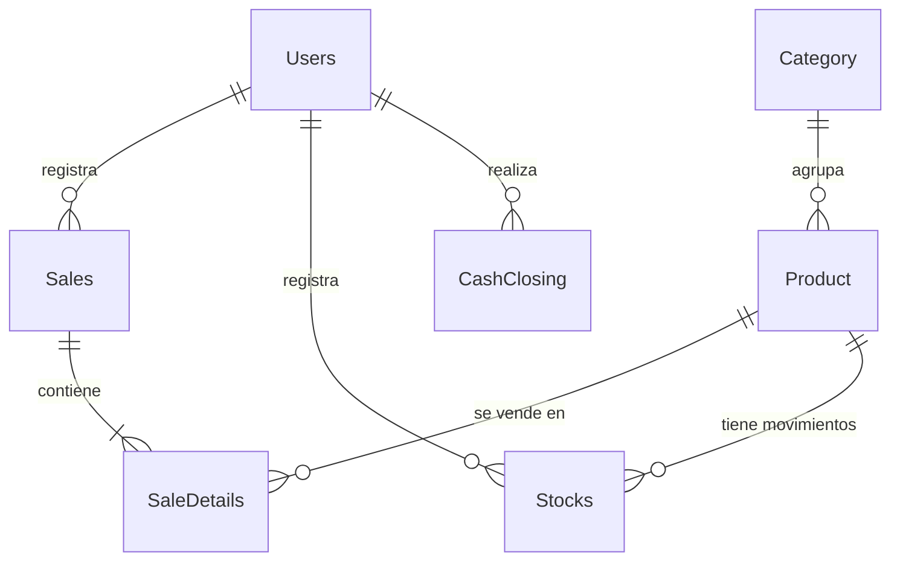

# Base de datos del proyecto POS

Documentación de la base de datos que usa la solución **POS San Magno**.

## Datos generales

| Elemento | Valor |
|---|---|
| Motor | Microsoft SQL Server 17.0 (Enterprise Evaluation, RTM) |
| Instancia | `LAPTOP-VVQV1RGN\MSSQLSERVER01` |
| Base de datos | `POSDB` |
| Cotejamiento | `Modern_Spanish_CI_AS` |
| ORM | Entity Framework Core 9.0.22 |
| Migraciones aplicadas | `20261111125614_InitialDB`, `20261119124714_AddCustomersAndDispatches`, `20261119135153_UniqueUserEmail` |
| Autenticación | Windows (Integrated Security) |

Cadena de conexión usada por `POS.Server/appsettings.json`:

```text
Data Source=LAPTOP-VVQV1RGN\MSSQLSERVER01;Initial Catalog=POSDB;Integrated Security=True;Encrypt=True;TrustServerCertificate=True;MultipleActiveResultSets=False
```

## Estado actual de los datos

| Tabla | Filas |
|---|---:|
| `Users` | 2 |
| `Category` | 7 |
| `Product` | 18 |
| `Sales` | 18 |
| `SaleDetails` | 43 |
| `Stocks` | 61 |
| `CashClosing` | 0 |
| `Customers` | 0 |
| `Dispatches` | 0 |
| `DispatchDetails` | 0 |

Los datos de catálogo y ventas son de demostración: 6 categorías de negocio (Bebidas, Snacks, Lácteos, Abarrotes, Limpieza y Panadería) más la categoría preexistente de prueba, 18 productos con códigos `BEB-001`…`PAN-002` y 18 ventas por un total de **Bs 462,60** repartidas en tres semanas. Los 61 movimientos de `Stocks` corresponden a las entradas iniciales y a las salidas de esas ventas, y `CurrentStock` refleja el saldo real (ningún producto queda en negativo).

Hay 1 administrador activo y 1 cajero activo. Las contraseñas se guardan como hash BCrypt en `Users.PasswordHash` (nunca en texto plano).

Los importes (`Price`, `TotalAmount`, `UnitPrice`, `TotalPrice`, `FinalBalance`, etc.) se almacenan como `decimal` **sin símbolo** y se interpretan como bolivianos (Bs); el formato de moneda lo aplica el cliente.

## Diagrama de relaciones



## Tablas

### `Users`

| Columna | Tipo | Nulo | Clave | Descripción |
|---|---|:---:|---|---|
| `Id` | `int` IDENTITY(1,1) | No | PK | Identificador |
| `Name` | `nvarchar(max)` | Sí | | Nombre completo |
| `Email` | `nvarchar(max)` | Sí | | Correo (se normaliza a minúsculas) |
| `Username` | `nvarchar(max)` | Sí | | Reservado, sin uso actual |
| `PasswordHash` | `nvarchar(max)` | Sí | | Hash BCrypt; excluido del JSON |
| `Role` | `int` | No | | `0` = Administrador, `1` = Cajero |
| `IsActive` | `bit` | No | | Baja/alta lógica |

### `Category`

| Columna | Tipo | Nulo | Clave | Descripción |
|---|---|:---:|---|---|
| `Id` | `int` IDENTITY(1,1) | No | PK | Identificador |
| `Name` | `nvarchar(max)` | Sí | | Nombre de la categoría |
| `Description` | `nvarchar(max)` | Sí | | Descripción |

### `Product`

| Columna | Tipo | Nulo | Clave | Descripción |
|---|---|:---:|---|---|
| `Id` | `int` IDENTITY(1,1) | No | PK | Identificador |
| `Code` | `nvarchar(100)` | No | UNIQUE | Código único del producto |
| `Name` | `nvarchar(max)` | Sí | | Nombre |
| `Description` | `nvarchar(max)` | Sí | | Descripción |
| `Price` | `decimal(18,2)` | No | | Precio unitario |
| `CurrentStock` | `int` | No | | Existencias actuales |
| `StockMinimun` | `int` | No | | Stock mínimo (typo histórico, no renombrar) |
| `CategoryId` | `int` | No | FK → `Category.Id` | Categoría |
| `IsActive` | `bit` | No | | Baja/alta lógica |
| `ImageUrl` | `nvarchar(max)` | Sí | | URL de imagen |

### `Sales`

| Columna | Tipo | Nulo | Clave | Descripción |
|---|---|:---:|---|---|
| `Id` | `int` IDENTITY(1,1) | No | PK | Número de venta |
| `SaleDate` | `datetime2` | No | | Fecha/hora de la venta |
| `TotalAmount` | `decimal(18,2)` | No | | Total de la venta |
| `UserId` | `int` | No | FK → `Users.Id` | Vendedor |
| `PaymentMethod` | `int` | No | | `0` = Efectivo, `1` = Tarjeta, `2` = Transferencia |

### `SaleDetails`

| Columna | Tipo | Nulo | Clave | Descripción |
|---|---|:---:|---|---|
| `Id` | `int` IDENTITY(1,1) | No | PK | Identificador |
| `SaleId` | `int` | No | FK → `Sales.Id` | Venta (borrado en cascada) |
| `ProductId` | `int` | No | FK → `Product.Id` | Producto (borrado restringido) |
| `Quantity` | `int` | No | | Cantidad vendida |
| `UnitPrice` | `decimal(18,2)` | No | | Precio al momento de la venta |
| `TotalPrice` | `decimal(18,2)` | No | | `Quantity × UnitPrice` |

### `Stocks`

| Columna | Tipo | Nulo | Clave | Descripción |
|---|---|:---:|---|---|
| `Id` | `int` IDENTITY(1,1) | No | PK | Identificador |
| `ProductId` | `int` | No | FK → `Product.Id` | Producto |
| `MovementDate` | `datetime2` | No | | Fecha/hora del movimiento |
| `MovementType` | `int` | No | | `0` = Entrada, `1` = Salida, `2` = Ajuste |
| `Quantity` | `int` | No | | Cantidad del movimiento |
| `Notes` | `nvarchar(max)` | Sí | | Observaciones |
| `UserId` | `int` | No | FK → `Users.Id` | Usuario que registra |

### `CashClosing`

| Columna | Tipo | Nulo | Clave | Descripción |
|---|---|:---:|---|---|
| `Id` | `int` IDENTITY(1,1) | No | PK | Identificador |
| `StartDate` | `datetime2` | No | | Inicio del período (fin del cierre anterior) |
| `EndDate` | `datetime2` | No | | Fin del período |
| `InitialBalance` | `decimal(18,2)` | No | | Saldo inicial |
| `TotalCash` | `decimal(18,2)` | No | | Ventas en efectivo |
| `TotalCard` | `decimal(18,2)` | No | | Ventas con tarjeta |
| `TotalTransfer` | `decimal(18,2)` | No | | Ventas por transferencia |
| `TotalAdjustments` | `decimal(18,2)` | No | | Ajustes manuales |
| `FinalBalance` | `decimal(18,2)` | No | | Saldo final total |
| `FinalCash` | `decimal(18,2)` | No | | Saldo final en efectivo |
| `UserId` | `int` | No | FK → `Users.Id` | Usuario que realiza el cierre |
| `Notes` | `nvarchar(max)` | Sí | | Observaciones |

## Índices y llaves foráneas

| Tabla | Índice | Único | Columnas |
|---|---|:---:|---|
| `Product` | `IX_Product_Code` | Sí | `Code` |
| `Product` | `IX_Product_CategoryId` | No | `CategoryId` |
| `Sales` | `IX_Sales_UserId` | No | `UserId` |
| `SaleDetails` | `IX_SaleDetails_SaleId` | No | `SaleId` |
| `SaleDetails` | `IX_SaleDetails_ProductId` | No | `ProductId` |
| `Stocks` | `IX_Stocks_ProductId` | No | `ProductId` |
| `Stocks` | `IX_Stocks_UserId` | No | `UserId` |
| `CashClosing` | `IX_CashClosing_UserId` | No | `UserId` |

| Llave foránea | Borrado |
|---|---|
| `Product.CategoryId → Category.Id` | CASCADE |
| `Sales.UserId → Users.Id` | CASCADE |
| `SaleDetails.SaleId → Sales.Id` | CASCADE |
| `SaleDetails.ProductId → Product.Id` | NO ACTION |
| `Stocks.ProductId → Product.Id` | CASCADE |
| `Stocks.UserId → Users.Id` | CASCADE |
| `CashClosing.UserId → Users.Id` | CASCADE |

## Enumeraciones

| Enum | Valores |
|---|---|
| `Role` | `0` Administrador, `1` Cajero |
| `PaymentMethod` | `0` Efectivo, `1` Tarjeta, `2` Transferencia |
| `MovementType` | `0` Entrada, `1` Salida, `2` Ajuste |

Los enums viajan como enteros entre cliente y servidor (comportamiento por defecto de `System.Text.Json`).

## Creación y actualización

La base se crea/actualiza con migraciones de EF Core. El servidor ejecuta `Database.MigrateAsync()` al arrancar (`POS.Server/Data/DbSeeder.cs`), por lo que también se crea sola si no existe.

Comandos manuales equivalentes:

```powershell
dotnet ef database update --project POS.Server
```

Crear una nueva migración tras cambiar entidades:

```powershell
dotnet ef migrations add NombreDeLaMigracion --project POS.Server
```

## Cambiar la conexión de base de datos del proyecto

La cadena que usa la API está en `POS.Server/appsettings.json`, sección `ConnectionStrings:DefaultConnection`:

```json
{
  "ConnectionStrings": {
    "DefaultConnection": "Data Source=LAPTOP-VVQV1RGN\\MSSQLSERVER01;Initial Catalog=POSDB;Integrated Security=True;Encrypt=True;TrustServerCertificate=True;MultipleActiveResultSets=False"
  }
}
```

El código la lee en `POS.Server/Program.cs` con `GetConnectionString("DefaultConnection")`. No hay otra cadena de conexión en el cliente ni en `POS.Shared`.

### Qué parámetro cambiar según el caso

| Parámetro | Qué cambiar |
|---|---|
| `Data Source` | Servidor e instancia. Ejemplos: `localhost`, `.\SQLEXPRESS`, `localhost,1433`, `MI-PC\\MSSQLSERVER01`, `mi-servidor.database.windows.net` |
| `Initial Catalog` | Nombre de la base. Si cambia, debe existir o se crea con migraciones |
| `Integrated Security` | `True` para autenticación de Windows; `False` (o quitarlo) si usas usuario/contraseña SQL |
| `User ID` / `Password` | Solo con autenticación SQL. No los subas al repositorio |
| `Encrypt` | `True` recomendado; en local puedes necesitar `TrustServerCertificate=True` |
| `TrustServerCertificate` | `True` para certificados autofirmados en desarrollo; `False` en producción con certificado válido |
| `MultipleActiveResultSets` | Déjalo en `False` para esta app |

### Ejemplos de cadenas

SQL Server local con autenticación de Windows:

```text
Data Source=localhost;Initial Catalog=POSDB;Integrated Security=True;Encrypt=True;TrustServerCertificate=True
```

Instancia con nombre en otra máquina:

```text
Data Source=192.168.1.50\MSSQLSERVER01;Initial Catalog=POSDB;Integrated Security=True;Encrypt=True;TrustServerCertificate=True
```

SQL Server con usuario y contraseña:

```text
Data Source=localhost,1433;Initial Catalog=POSDB;User ID=pos_app;Password=TuClaveSegura;Encrypt=True;TrustServerCertificate=True
```

Azure SQL / SQL Server remoto con certificado válido:

```text
Server=tcp:mi-servidor.database.windows.net,1433;Initial Catalog=POSDB;User ID=pos_app;Password=TuClaveSegura;Encrypt=True;TrustServerCertificate=False
```

### Cambiarla sin tocar el repositorio

En desarrollo, usa `user-secrets`:

```powershell
dotnet user-secrets init --project POS.Server
dotnet user-secrets set "ConnectionStrings:DefaultConnection" "Data Source=localhost;Initial Catalog=POSDB;Integrated Security=True;Encrypt=True;TrustServerCertificate=True" --project POS.Server
```

En producción o CI, usa una variable de entorno (los `:` se reemplazan por `__`):

```powershell
$env:ConnectionStrings__DefaultConnection = "Data Source=localhost;Initial Catalog=POSDB;Integrated Security=True;Encrypt=True;TrustServerCertificate=True"
```

Alternativa: crear `POS.Server/appsettings.Production.json` (sin subirlo) con:

```json
{
  "ConnectionStrings": {
    "DefaultConnection": "Server=tcp:mi-servidor,1433;Initial Catalog=POSDB;User ID=pos_app;Password=TuClaveSegura;Encrypt=True;TrustServerCertificate=False"
  }
}
```

### Después de cambiarla

1. Verifica que el servidor sea accesible:
   ```powershell
   sqlcmd -S "localhost" -d POSDB -E -C -Q "SELECT @@VERSION"
   ```
2. Arranca la API; `DbSeeder` aplica migraciones pendientes y crea el administrador inicial si no existe.
3. Si la base ya existía pero sin migraciones, ejecuta:
   ```powershell
   dotnet ef database update --project POS.Server
   ```
4. Configura `AdminSeed` en `appsettings.Development.json` (o mediante variables de entorno) para poder iniciar sesión en una base nueva.
5. Si usas autenticación de Windows, la cuenta que ejecuta la API (o el usuario de IIS/App Pool) necesita permisos sobre `POSDB`; con autenticación SQL, crea el login/usuario y dale permisos en la base.

### Errores comunes

| Error | Causa probable |
|---|---|
| `A network-related or instance-specific error` | Instancia mal escrita, SQL Server detenido, TCP/IP deshabilitado o firewall |
| `Login failed for user` | Usuario sin permisos, contraseña incorrecta o `Integrated Security=True` con una cuenta sin acceso |
| `Cannot open database "POSDB"` | La base no existe y el usuario no tiene permiso para crearla |
| `The certificate chain was issued by an authority that is not trusted` | Usa `TrustServerCertificate=True` en desarrollo |
| La API arranca pero falla al consultar | Cadena válida pero apuntando a otra base sin migraciones |

## DDL de referencia

Script equivalente al esquema actual. Úsalo solo como referencia; para el proyecto se recomiendan las migraciones de EF Core.

```sql
IF DB_ID('POSDB') IS NULL
    CREATE DATABASE POSDB;
GO
USE POSDB;
GO

CREATE TABLE Category (
    Id          INT IDENTITY(1,1) NOT NULL CONSTRAINT PK_Category PRIMARY KEY,
    Name        NVARCHAR(MAX) NULL,
    Description NVARCHAR(MAX) NULL
);

CREATE TABLE Users (
    Id           INT IDENTITY(1,1) NOT NULL CONSTRAINT PK_Users PRIMARY KEY,
    Name         NVARCHAR(MAX) NULL,
    Email        NVARCHAR(MAX) NULL,
    Username     NVARCHAR(MAX) NULL,
    PasswordHash NVARCHAR(MAX) NULL,
    Role         INT NOT NULL,
    IsActive     BIT NOT NULL
);

CREATE TABLE Product (
    Id           INT IDENTITY(1,1) NOT NULL CONSTRAINT PK_Product PRIMARY KEY,
    Code         NVARCHAR(100) NOT NULL,
    Name         NVARCHAR(MAX) NULL,
    Description  NVARCHAR(MAX) NULL,
    Price        DECIMAL(18,2) NOT NULL,
    CurrentStock INT NOT NULL,
    StockMinimun INT NOT NULL,
    CategoryId   INT NOT NULL,
    IsActive     BIT NOT NULL,
    ImageUrl     NVARCHAR(MAX) NULL,
    CONSTRAINT FK_Product_Category_CategoryId
        FOREIGN KEY (CategoryId) REFERENCES Category (Id) ON DELETE CASCADE
);

CREATE TABLE Sales (
    Id            INT IDENTITY(1,1) NOT NULL CONSTRAINT PK_Sales PRIMARY KEY,
    SaleDate      DATETIME2 NOT NULL,
    TotalAmount   DECIMAL(18,2) NOT NULL,
    UserId        INT NOT NULL,
    PaymentMethod INT NOT NULL,
    CONSTRAINT FK_Sales_Users_UserId
        FOREIGN KEY (UserId) REFERENCES Users (Id) ON DELETE CASCADE
);

CREATE TABLE SaleDetails (
    Id         INT IDENTITY(1,1) NOT NULL CONSTRAINT PK_SaleDetails PRIMARY KEY,
    SaleId     INT NOT NULL,
    ProductId  INT NOT NULL,
    Quantity   INT NOT NULL,
    UnitPrice  DECIMAL(18,2) NOT NULL,
    TotalPrice DECIMAL(18,2) NOT NULL,
    CONSTRAINT FK_SaleDetails_Sales_SaleId
        FOREIGN KEY (SaleId) REFERENCES Sales (Id) ON DELETE CASCADE,
    CONSTRAINT FK_SaleDetails_Product_ProductId
        FOREIGN KEY (ProductId) REFERENCES Product (Id)
);

CREATE TABLE Stocks (
    Id           INT IDENTITY(1,1) NOT NULL CONSTRAINT PK_Stocks PRIMARY KEY,
    ProductId    INT NOT NULL,
    MovementDate DATETIME2 NOT NULL,
    MovementType INT NOT NULL,
    Quantity     INT NOT NULL,
    Notes        NVARCHAR(MAX) NULL,
    UserId       INT NOT NULL,
    CONSTRAINT FK_Stocks_Product_ProductId
        FOREIGN KEY (ProductId) REFERENCES Product (Id) ON DELETE CASCADE,
    CONSTRAINT FK_Stocks_Users_UserId
        FOREIGN KEY (UserId) REFERENCES Users (Id) ON DELETE CASCADE
);

CREATE TABLE CashClosing (
    Id               INT IDENTITY(1,1) NOT NULL CONSTRAINT PK_CashClosing PRIMARY KEY,
    StartDate        DATETIME2 NOT NULL,
    EndDate          DATETIME2 NOT NULL,
    InitialBalance   DECIMAL(18,2) NOT NULL,
    TotalCash        DECIMAL(18,2) NOT NULL,
    TotalCard        DECIMAL(18,2) NOT NULL,
    TotalTransfer    DECIMAL(18,2) NOT NULL,
    TotalAdjustments DECIMAL(18,2) NOT NULL,
    FinalBalance     DECIMAL(18,2) NOT NULL,
    FinalCash        DECIMAL(18,2) NOT NULL,
    UserId           INT NOT NULL,
    Notes            NVARCHAR(MAX) NULL,
    CONSTRAINT FK_CashClosing_Users_UserId
        FOREIGN KEY (UserId) REFERENCES Users (Id) ON DELETE CASCADE
);

CREATE UNIQUE INDEX IX_Product_Code ON Product (Code);
CREATE INDEX IX_Product_CategoryId ON Product (CategoryId);
CREATE INDEX IX_Sales_UserId ON Sales (UserId);
CREATE INDEX IX_SaleDetails_SaleId ON SaleDetails (SaleId);
CREATE INDEX IX_SaleDetails_ProductId ON SaleDetails (ProductId);
CREATE INDEX IX_Stocks_ProductId ON Stocks (ProductId);
CREATE INDEX IX_Stocks_UserId ON Stocks (UserId);
CREATE INDEX IX_CashClosing_UserId ON CashClosing (UserId);
```

Si se crea manualmente con este script, registrar la migración para que EF no intente recrear las tablas:

```sql
IF OBJECT_ID('__EFMigrationsHistory', 'U') IS NULL
BEGIN
    CREATE TABLE __EFMigrationsHistory (
        MigrationId    NVARCHAR(150) NOT NULL CONSTRAINT PK___EFMigrationsHistory PRIMARY KEY,
        ProductVersion NVARCHAR(32) NOT NULL
    );
    INSERT INTO __EFMigrationsHistory (MigrationId, ProductVersion)
    VALUES ('20261111125614_InitialDB', '9.0.22');
END
```

## Consultas útiles

Ventas de hoy:

```sql
SELECT Id, SaleDate, PaymentMethod, TotalAmount, UserId
FROM Sales
WHERE CAST(SaleDate AS date) = CAST(SYSDATETIME() AS date)
ORDER BY SaleDate DESC;
```

Total vendido por método de pago:

```sql
SELECT PaymentMethod,
       COUNT(*) AS Ventas,
       SUM(TotalAmount) AS Total
FROM Sales
GROUP BY PaymentMethod;
```

Productos con stock bajo:

```sql
SELECT Id, Code, Name, CurrentStock, StockMinimun
FROM Product
WHERE IsActive = 1 AND CurrentStock <= StockMinimun
ORDER BY CurrentStock;
```

Último cierre de caja:

```sql
SELECT TOP (1) *
FROM CashClosing
ORDER BY EndDate DESC;
```

Movimientos de stock de un producto:

```sql
SELECT Id, MovementDate, MovementType, Quantity, Notes, UserId
FROM Stocks
WHERE ProductId = @ProductId
ORDER BY MovementDate DESC;
```

## Notas

- Existe una tabla `sysdiagrams` creada por SQL Server Management Studio; **no la usa la aplicación**.
- En la base actual `Product.Code` es `nvarchar(100)`, aunque la migración original lo definió como `nvarchar(50)`; el esquema real manda.
- `Product.StockMinimun` conserva el typo histórico para no romper la BD ni las migraciones.
- `PasswordHash` nunca debe exponerse en respuestas HTTP: la entidad tiene `[JsonIgnore]`.
- La cadena de conexión usa autenticación integrada de Windows; no contiene usuario/contraseña.
- Para producción, configura `ConnectionStrings:DefaultConnection`, `JwtSettings` y `AdminSeed` con variables de entorno o un gestor de secretos.
